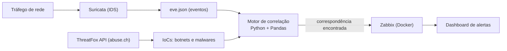

# SOC Pipeline Lab: Suricata, ThreatFox & Zabbix
Laboratório de **Security Operations Center (SOC)** que detecta, em tempo real, comunicações de rede suspeitas cruzando o tráfego capturado pelo **Suricata** com indicadores de comprometimento (IoCs) da **ThreatFox**, e envia os alertas validados para um dashboard no **Zabbix**.

> Projeto de estudo, criado para praticar monitoração de rede, Cyber Threat Intelligence (CTI) e automação de detecção com Python.

---

## Como funciona



| Camada | Ferramenta | Função |
|---|---|---|
| Detecção | Suricata | Monitora o tráfego em tempo real e gera eventos estruturados em `eve.json` |
| Inteligência | ThreatFox (abuse.ch) | Fornece IoCs atualizados, com foco em botnets e malwares |
| Correlação | Python + Pandas | Cruza os eventos do Suricata com os IoCs e identifica correspondências |
| Alertas | Zabbix (Server, Web e Agent via Docker) | Recebe os alertas validados e os exibe em um dashboard |

---

## Estrutura do repositório

| Arquivo | Descrição |
|---|---|
| `correlact.py` | Motor de correlação entre eventos do Suricata e IoCs da ThreatFox |
| `extractor.py` | Extração e tratamento dos dados de entrada |
| `stix_collector.py` |  Coleta de indicadores em formato STIX |
| `docker-compose.yml` | Sobe o Zabbix (Server, Web e banco de dados) |
| `requirements.txt` | Dependências Python |
| `.gitignore` | Exclui credenciais, ambiente virtual e logs do versionamento |

---

## Stack

- **Python 3**: Pandas, Requests, python-dotenv
- **Suricata**: IDS de rede
- **Zabbix**: Server, Web e Agent
- **Docker e Docker Compose**

---

## Pré-requisitos

- Python 3.x
- Docker e Docker Compose
- Suricata instalado e configurado para a interface de rede em uso (gerando o `eve.json`)
- Chave de API da ThreatFox (gratuita, emitida pelo [abuse.ch](https://abuse.ch/))

---

## Instalação e uso

### 1. Clonar o repositório e preparar o ambiente

```bash
git clone https://github.com/DerickMead7/network_traffic.git
cd network_traffic
```

Crie e ative o ambiente virtual:

```bash
# Windows
python -m venv venv
.\venv\Scripts\activate

# Linux / macOS
python3 -m venv venv
source venv/bin/activate
```

Instale as dependências:

```bash
pip install -r requirements.txt
```

### 2. Configurar as credenciais

Crie um arquivo `.env` na raiz do projeto:

```env
THREATFOX_API_KEY=sua_chave_de_api_aqui
```

### 3. Subir o Zabbix

```bash
docker-compose up -d
```

Depois acesse a interface web em <http://localhost:8080> e adicione o host local apontando para o IP da máquina na porta `10050` (Zabbix Agent).

> **Atenção:** altere a senha padrão do Zabbix no primeiro acesso.

### 4. Executar o pipeline

Com o Suricata rodando e gerando o `eve.json`, inicie o motor de correlação:

```bash
python correlact.py
```

A partir daí, o script inspeciona os eventos e reporta ao Zabbix toda correspondência com os IoCs.

---

## Segurança e boas práticas

Os itens abaixo ficam fora do versionamento (via `.gitignore`):

- Credenciais de API (`.env`)
- Ambiente virtual Python (`venv/`)
- Logs de tráfego de rede (`*.log`, `eve.json`)

Nunca publique a chave da ThreatFox nem logs de tráfego real, que podem conter endereços internos.

---

## Roadmap

- [ ] Bloqueio automatizado de IPs maliciosos no firewall local (Windows Defender / iptables)
- [ ] Suporte à ingestão de regras YARA personalizadas

---

## Competências praticadas

Monitoração de rede com IDS, ingestão e uso de Cyber Threat Intelligence (IoCs), correlação de eventos com Python/Pandas, integração com plataforma de monitoração (Zabbix) e infraestrutura como código com Docker Compose.

---

## Autor

**Derick**: estudante de Cibersegurança, interessado em SOC, automação e segurança de redes.
[GitHub](https://github.com/DerickMead7)
